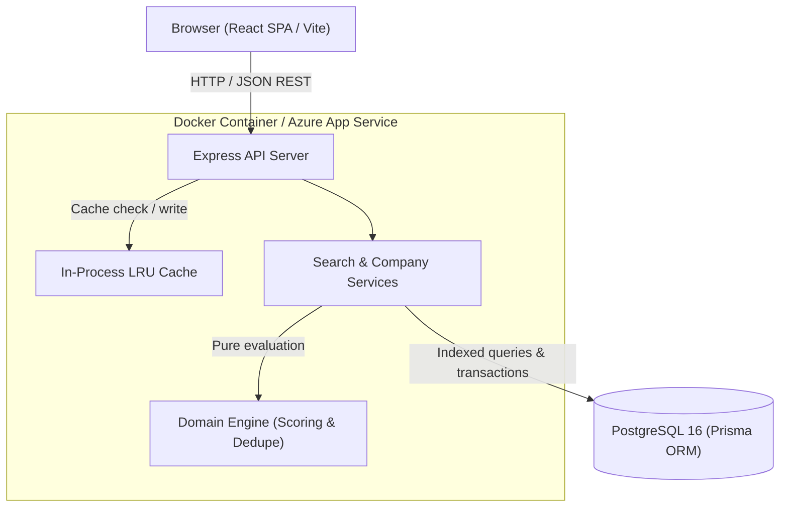
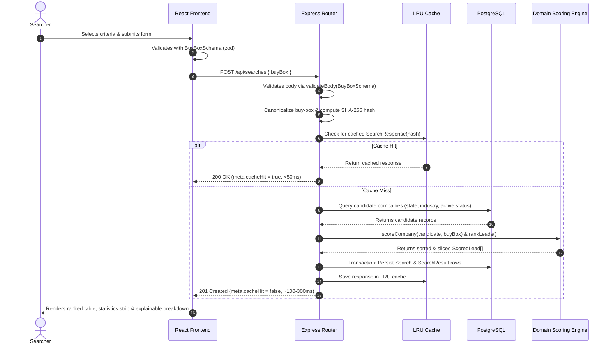
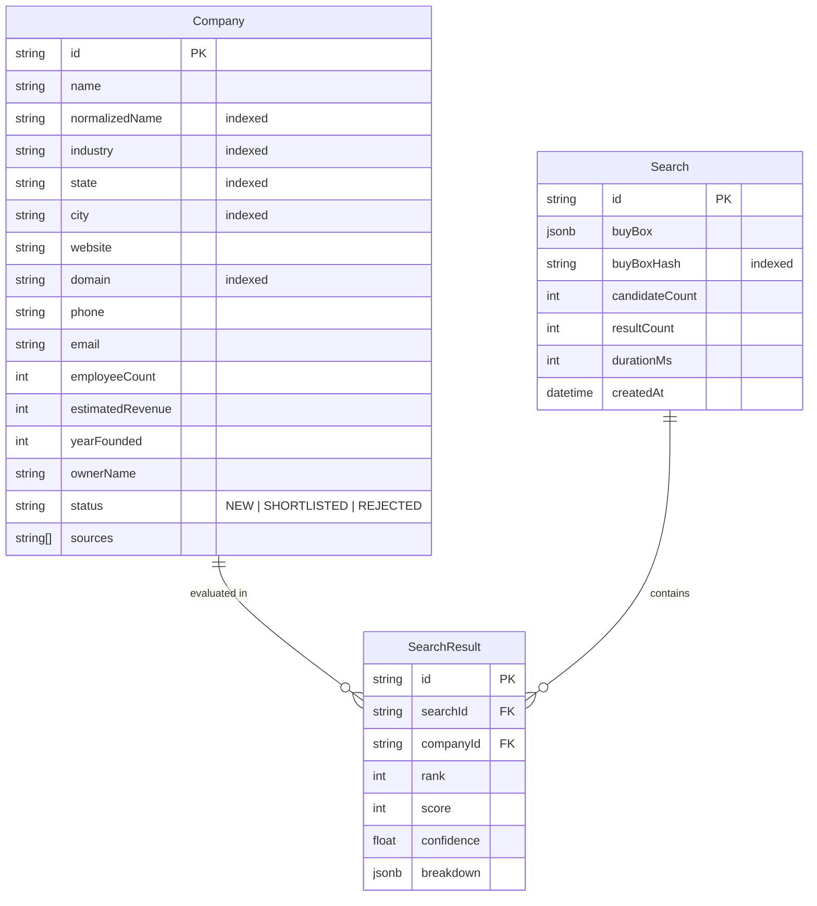

# BuyBox Radar — System Architecture

This document describes the architectural layout, request lifecycle, data model, and engineering tradeoffs of BuyBox Radar.

---

## 1. System Topology

---

## 2. Request Flow: Search & Fit Ranking

When a user defines a buy-box and clicks **Find & Rank Targets**:

---

## 3. Data Model & Indexing Strategy

### Composite Indexes:
- `Company(state, industry, status)`: Primary candidate retrieval query covering filters.
- `Company(normalizedName, city)`: Duplicate detection at ingest.
- `Company(domain)`: Exact domain record-linkage.
- `Search(buyBoxHash)`: Query audit lookups.
- `SearchResult(searchId, rank)`: Fast ordered retrieval for exports and historical lookups.

---

## 4. Key Architectural Decisions & Tradeoffs

| Area | Choice | Alternative Considered | Rationale & Tradeoffs |
|------|--------|------------------------|-----------------------|
| **Database** | **PostgreSQL 16 with Prisma** | MongoDB | Relational filtering across states, industries, and candidate statuses with foreign key integrity. Postgres JSONB provides schema-less flexibility for score breakdowns while maintaining SQL query speed. |
| **Scoring Execution** | **Query-time evaluation** | Precomputed scores | A company's fit is relative to an entrepreneur's bespoke thesis (buy-box). Evaluating 1,200 pure TypeScript functions takes < 10 ms, avoiding large combinatorial precalculation matrices. |
| **Caching Layer** | **In-memory LRU cache (`lru-cache`)** | Redis | Eliminates additional cloud infrastructure in a time-boxed MVP. Provides sub-millisecond cache hits for identical queries. Tradeoff: Cache is process-local and clears on container restart. Documented next step: Redis. |
| **Record Deduplication** | **Blocking by State + Union-Find Clustering** | Embeddings / LLMs | Deterministic, auditable, and extremely fast. Rules combine exact domain/phone matches, exact normalized names, and Levenshtein similarity ($> 0.92$) within city blocks. |
| **Packaging & Hosting** | **Single Multi-stage Docker Container** | Serverless / Decoupled FE/BE | Eliminates CORS issues in production, ensures unified versioning, and keeps the Node process warm for the in-memory LRU cache. Deploys cleanly to Azure App Service (Linux). |
| **Domain Logic Purity** | **Pure TypeScript domain functions** | Database-tied logic | Scoring and dedupe engines take plain objects and current timestamps as parameters, making them 100% deterministic, testable, and reusable on client or server. |
